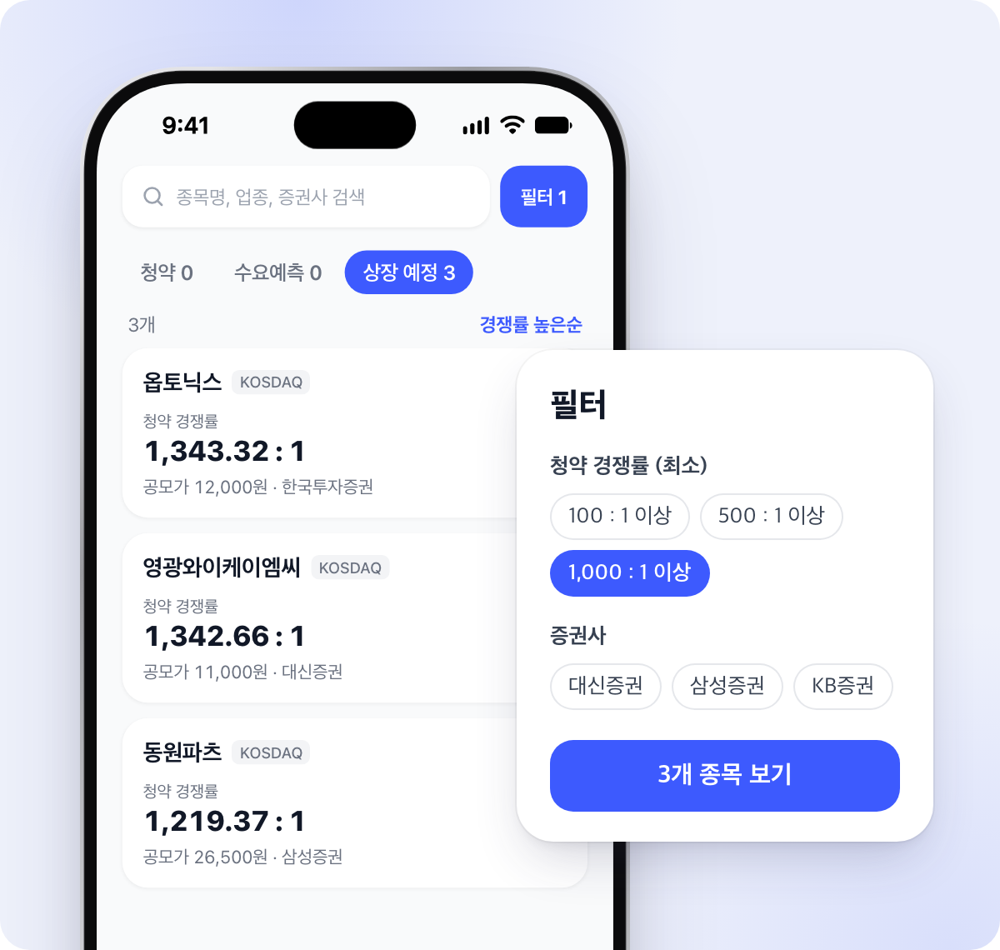

# 공모주 캘린더

국내 공모주의 수요예측·청약·상장 일정을 한눈에 볼 수 있는 모바일 웹앱입니다.
데이터는 매일 밤 12시(KST)에 자동으로 갱신됩니다.

**👉 [oyslucy.github.io/ipo-webapp](https://oyslucy.github.io/ipo-webapp/)**

<p align="center">
  
  
</p>

## 주요 기능

### 캘린더
- **이번 주 요약**: 이번 주(월~일)에 있는 청약·상장·수요예측 건수를 한 번에 보여줍니다.
- **월간 캘린더**: 날짜마다 일정 종류를 색 점으로 표시합니다. 청약은 파랑, 상장은 초록, 수요예측은 노랑입니다.
- 날짜를 누르면 그날 일정이 `청약 마감`, `수요예측 시작`처럼 어느 시점인지와 함께 나옵니다.
- 이틀 이상 이어지는 일정은 장이 열리지 않는 주말을 건너뛰고 표시합니다.

### 단계별 목록
- 청약 · 청약 예정 · 수요예측 · 상장 예정 · 심사 중 · 상장 완료 탭으로 나눠 보여줍니다.
- 카드마다 단계에 맞는 핵심 정보(일정, 공모가, 기관경쟁률, 청약경쟁률, 주관사)가 나옵니다.
- 상장일이 지난 종목은 '상장 완료' 탭으로 자동으로 옮겨집니다.

### 검색 / 필터 / 정렬
- **검색**: 종목명, 업종, 증권사로 찾을 수 있고 띄어쓰기는 무시합니다.
- **필터**: 증권사(주관사), 희망 공모가, 확정 공모가, 일정 날짜, 최소 기관 경쟁률, 최소 청약 경쟁률로 좁힐 수 있습니다.
- **정렬**: 일정순, 기관경쟁률·청약경쟁률 높은순·낮은순, 공모가 높은순·낮은순, 공모금액 큰순을 고를 수 있습니다.
- 검색과 필터는 캘린더와 목록에 모두 적용됩니다.

### 종목 상세
- **기관 경쟁률**과 청약 경쟁률을 맨 위에 보여줍니다. 청약이 진행 중이면 대표 증권사의 집계값을 대신 보여줍니다.
- **공모 정보**: 종목코드, 시장구분, 공모금액, 공모주식수, 희망·확정 공모가, 일반청약주식수, 청약 증거금률
- **청약 증권사**: 증권사별 통합·비례 경쟁률, 배정 물량, 최소 청약 수량, 균등·비례 배정, 청약 건수
- **일정**: 예비심사 청구부터 상장까지 순서대로 보여주고, 지난 단계·진행 중·예정을 색으로 구분합니다.
- **기업 정보**: 주요 제품, 대표자, 설립일, 직원 수, 기업 구분, 최대주주, 홈페이지, 주소
- **재무 정보**: 최근 3개 기간의 매출액·영업이익·순이익
- **공시 · 링크**: 투자설명서·증권신고서(DART)와 네이버 증권 상세 페이지

## 동작 방식

```
GitHub Actions (매일 00:00 KST)
  └─ 수집 스크립트 (공모주 목록 + 종목별 상세) → apps/web/public/data/ipos.json 갱신 후 커밋
       └─ GitHub Pages에 다시 배포 → 웹이 정적 JSON을 읽어 표시
```

- 네이버 목록에서 빠진 종목도 지우지 않고 이력으로 남기기 때문에, 상장 완료 종목은 시간이 지날수록 쌓입니다.
- 날짜 계산은 모두 한국 시간 기준입니다.

## 프로젝트 구조

```
apps/
├─ web/   React + Vite + TypeScript + Tailwind CSS + Motion
│   ├─ src/domain/      탭 분류, 일정, 검색·필터·정렬 등 순수 로직 (테스트 포함)
│   ├─ src/components/  화면 컴포넌트
│   └─ public/data/     수집된 데이터 (ipos.json)
└─ api/   Python 3.12 + uv, 데이터 수집 스크립트
.github/workflows/
├─ collect.yml  매일 데이터 수집
├─ deploy.yml   GitHub Pages 배포
└─ ci.yml       lint · 타입 검사 · 테스트
```

## 로컬에서 실행하기

```bash
# 웹
npm install
npm run dev

# 데이터 수집 (apps/web/public/data/ipos.json 갱신)
cd apps/api
uv run collect
```

테스트:

```bash
npm test -w @ipo/web          # 웹
cd apps/api && uv run pytest  # 수집 스크립트
```

## 데이터 출처

[네이버페이 증권 공모주 페이지](https://stock.naver.com/market/stock/kr/ipo)의 데이터를 사용합니다.
비공식 데이터라 실제와 다를 수 있으며, 투자 판단의 근거로 사용하기 전에 반드시 공식 공시를 확인하세요.
